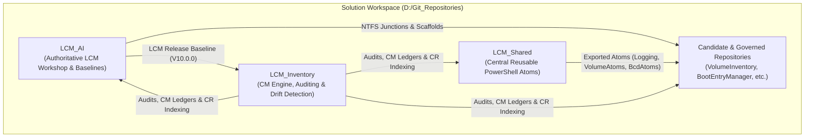

# Workspace Active Context & LCM Operational Manifest

**Last Updated:** 2026-11-10 20:52:50  
**Workspace Root:** `D:\Git_Repositories`  
**Governance Framework:** Lifecycle Model (LCM V10.0.0)  
**Parent Workspace:** `D:\VSCode-Workspaces\Solution.code-workspace`

---

## 1. Core LCM Methodology Pillars

The workspace operates on a triadic governance and implementation structure:

1. **[LCM_AI](file:///d:/Git_Repositories/LCM_AI/README.md) (Governance & Methodology Baseline Authority):**
   * Releases and maintains the authoritative LCM standard (currently `V10.0.0`).
   * Owns repository templates (`templates/repo-scaffold/`), onboarding engines (`Invoke-LCMOnboardRepo.ps1`), and quality gates (`WorkspaceQualityGates.psm1`, `Test-WorkspaceReadiness.ps1`).
   * Projects governance via NTFS directory junctions into onboarded repositories.

2. **[LCM_Inventory](file:///d:/Git_Repositories/LCM_Inventory/README.md) (Configuration Management & Auditing):**
   * Tracks lifecycle state across all 33+ directories under `D:\Git_Repositories\`.
   * Classifies directories: `active-design-workshop`, `lcm-governed`, `standard-git`, `non-git`, `legacy-retired`, `parent-infra`.
   * Manages append-only CM audit trail (`logs/cm_activity.log`), baseline snapshots (`data/baselines/`), and global Change Request (CR) indexes.

3. **[LCM_Shared](file:///d:/Git_Repositories/LCM_Shared/README.md) (Central Reusable PowerShell Atoms):**
   * Decoupled library of reusable functional modules:
     * `Logging.psm1`: Structured session logging and transcript capture.
     * `VolumeAtoms.psm1`: Low-level volume, serial, `fltmc`, and EFI System Partition resolution.
     * `BcdAtoms.psm1`: Boot Configuration Data parser and dual-format backup generator.
     * `PrivatePaths.psm1` & `TranscriptTools.psm1`: Path resolution and transcript tools.

---

## 2. Environment & Tooling Invariants

* **Tooling Authority Root:** `D:\Tools\`
* **Python Runtime:** Python 3.14 Base at `D:\Tools\Python314\python.exe` and Shared Virtualenv at `D:\Git_Repositories\.venv\Scripts\python.exe` (with `google-antigravity` SDK).
* **PowerShell Runtime:** PowerShell 7 (`pwsh.exe` 7.0+) at `D:\Tools\PowerShell\7\pwsh.exe`.
* **Visual Differential Review:** Beyond Compare 5 at `D:\Tools\Beyond Compare 5\BCompare.exe` via `Invoke-BeyondCompareReview.ps1` / `Submit-ReviewResult.ps1` (`RR.ps1`).
* **Fast Search & Content Indexing:** `Everything.exe` and `es.exe` (v1.5.0.1418b (x64)+) at `D:\Tools\Everything 1.5a\`.
  * Index Database: `A:\EverythingIndex\Everything.db` (Indexed roots: `D:\Git_Repositories\**`, `D:\Tools\**`, `D:\OneDrive\Documents\**`).
  * IPC Communication: `\\.\pipe\Everything IPC`.
* **Permanent Memory Architecture:** LCM durable memory is formally anchored across reboots in:
  1. `.agents/ACTIVE_CONTEXT.md` (Workspace state and active work streams)
  2. `.copilot/CopilotTools.md` (Tool paths and indexer specifications)
  3. `.agents/rules/` (Authoritative invariant rules)
  4. [`.agents/LEARNED_ADVICE.md`](./LEARNED_ADVICE.md) (Learned advice from operator and AIs; accepted entries are binding, `/learn` adds candidates; read at session start together with this file)
* **IDE Settings ([.vscode/settings.json](file:///d:/Git_Repositories/.vscode/settings.json)):**
  * `antigravity.toolExecutionPolicy`: `always-proceed`
  * `antigravity.fileAccessPolicy`: `allow`
  * `antigravity.terminalExecutionPolicy`: `always-proceed`
  * `antigravity.autoExecuteCommands`: `true`
  * `files.eol`: `\r\n` (CRLF)
  * `files.encoding`: `utf8` (without BOM)
  * `git.ignoredRepositories`: Includes all 10 non-git directories.

---

## 3. LCM Governance Rules & Exceptions

All rules in [.agents/rules/](file:///d:/Git_Repositories/.agents/rules/) are authoritative:

1. **[ReviewCommitGovernancePolicy.md](file:///d:/Git_Repositories/.agents/rules/ReviewCommitGovernancePolicy.md):**
   * `RULE-REV-001`: Commits require prior validated review disposition (`ACCEPTED` / `ACCEPTED_WITH_EDITS`).
   * `RULE-REV-004`: Review-gating takes strict precedence over general permissions.
   * **Exemption:** `HaSSD06` workspace is **exempt** from mandatory review-gating.
2. **[MethodEfficiencyPolicy.md](file:///d:/Git_Repositories/.agents/rules/MethodEfficiencyPolicy.md):**
   * `RULE-EFF-001`: Mechanical telemetry, baseline snapshots, and logs are automatically accepted without review gates.
   * `RULE-EFF-002`: Zero-test cascade on log/evidence mutations.
   * `RULE-EFF-004`: Direct agent execution without chat planning blocks; gating handled exclusively downstream via Beyond Compare (`RR.ps1`).
3. **[ElevationPolicy.md](file:///d:/Git_Repositories/.agents/rules/ElevationPolicy.md):**
   * `RULE-ELEV-001` through `RULE-ELEV-003`: Explicit `execution_context` in `LCM_Inventory/config.json`; `-NoElevation` support for automated runners.
4. **[LanguagePolicy.md](file:///d:/Git_Repositories/.agents/rules/LanguagePolicy.md):**
   * English required across code, comments, and docs (with translation task exceptions).
5. **[RepositoryContextPolicy.md](file:///d:/Git_Repositories/.agents/rules/RepositoryContextPolicy.md):**
   * `RULE-CTX-001`: Active document / path scope resolution.
   * `RULE-CTX-002`: Fast-tier ingestion (`LCM_Inventory/config.json`, `README.md`, proposals) with unonboarded candidate fallback.
   * `RULE-CTX-003`: Zero redundant scan invariant.
   * `RULE-CTX-004`: Continuous methodology triad awareness.
   * `RULE-CTX-005`: Learned advice; read `ACTIVE_CONTEXT.md` and `LEARNED_ADVICE.md` at session start, accepted entries are binding, `/learn` adds candidates, review no later than push.
   * `RULE-CTX-006`: GoodMorning session start; run `Invoke-WorkspaceGoodMorning.ps1 -Auto`, report attention items first, confirm the context files were read (read-only).

---

## 4. Active Work Streams & Task State

### Stream A: Home Assistant / Tuya $\rightarrow$ IKEA Migration ([HaSSD06](file:///d:/Git_Repositories/HaSSD06/))
* **Goal:** Migrate 11 Tuya WLAN smart plugs to IKEA Zigbee (INSPELNING / TRETAKT) on Zigbee2MQTT (Sonoff MG24 Dongle, Channel 25).
* **Key Artifacts:**
  * Mapping matrix: [tuya_ikea_mapping_matrix.csv](file:///d:/Git_Repositories/HaSSD06/docs/Migration/tuya_ikea_mapping_matrix.csv)
  * Checklist: [MIGRATION_CHECKLIST.md](file:///d:/Git_Repositories/HaSSD06/docs/Migration/MIGRATION_CHECKLIST.md)
  * MCP Server: `homeassistant-readonly` (`http://192.168.10.6:8123`)

### Stream B: Workspace AI & Antigravity Setup
* Shared `.venv` installed and verified (Python 3.14 + `google-antigravity` SDK).
* Antigravity settings configured to `always-proceed` + `allow` across all `.vscode/settings.json`.
* Rule `RULE-EFF-004` (Agent direct execution + Beyond Compare review gating) active and enforced.

### Stream C: CI Stabilization & Pester v5 Modernization
* **Completed Repositories:**
  * `VolumeInventory`: Pester v5 tests verified, pre-push hook active (`1a252c5`).
  * `BootEntryManager`: Modernized assertions to Pester v5, pre-push hook active, reviewed & pushed (`031caa2`).
  * `LCM_Shared`: Modernized assertions to Pester v5, pre-push hook active, reviewed & pushed (`06c4c86`).
  * `LCM_AI`: Quality gate `Assert-PesterV5Syntax` and pre-push scaffold deployed, reviewed & pushed (`40e345b`).
  * `LCM_Inventory`: `Invoke-BeyondCompareReview.ps1` fixed (`HEAD` default, absolute paths, interactive desktop launcher `/it`), reviewed & pushed (`391fa4f`).
* **Session Snapshot:** The current state is the auto-generated `Session Snapshot` block at the end of this file (written by `Save-AllSessionMemory.ps1`, read by GoodMorning). Earlier hand-kept snapshots (`LCM_Inventory/docs/ACTIVE_SESSION_CONTEXT.md`, `LCM_Inventory/data/session_state/SESSION_SNAPSHOT_20260818.json`) are historical (2026-08/10) and not authoritative.

---

## Operator Remarks (open, for the next session)

### 2026-11-08: Master Consolidation Plan (CRP-309 & COH-307)

Master consolidation agreed with operator before reboot:
1. **Phase 1 (Clear Backlog):** Review and complete verified cohort `COH-307` (`CRP-304`, `CRP-305`, `CRP-306`, `BUG-307`, `CRP-298`).
2. **Phase 2 (Master Proposal CRP-309):** Execute unified elevated Port 9876 daemon (`RunLevel Highest`), universal synchronous back-channel, thin-client REST routes, rich feedback drawer, binding CORS/CSP (`ShowTools -Pane`), JIT ephemeral tokens (`Authenticated Users` SID S-1-5-11), and `Invoke-InteractiveDesktop.ps1` short-circuit remediation. Absorbs and supersedes: `CRP-292` through `CRP-297`, `BUG-289`, and `CRP-248`.
3. **Phase 3 (GoodMorning & Baseline CRP-308):** Deploys context remarks editor tool, default baseline readiness, and Macrium automation atoms. Absorbs and supersedes `CRP-258`.
4. Detailed specifications and implementation plans updated in `LCM_Inventory/docs/Proposals/CRP-309-*/`.

### 2026-10-20: Review/commit workflow friction for tomorrow

Analyze these workflow mismatches with the operator before changing policy or tooling. The accepted work is allowed to be committed while its proposal remains unfinished; a commit is not lifecycle completion.

1. **Accepted changes under `data/`:** [`LCM_Inventory/tools/Submit-ReviewResult.ps1`](../../LCM_Inventory/tools/Submit-ReviewResult.ps1) excludes `data/` in its normal path filter. `-StagedOnly` allows `data/proposals/proposals.json` only, so the accepted catalog refresh in `data/catalog/apps.json` and `data/adminmode.json` could not use RR. Operator authorized those exact paths for commit, but the pre-commit hook then blocked a direct commit without its one-use RR authorization.
2. **Conflicting commit routes:** [`LCM_Inventory/tools/Test-ReviewCommitGate.ps1`](../../LCM_Inventory/tools/Test-ReviewCommitGate.ps1) enforces exact RR authorization, while [`LCM_Inventory/tools/Invoke-WorkspaceGoodNight.ps1`](../../LCM_Inventory/tools/Invoke-WorkspaceGoodNight.ps1) commits with `--no-verify`. Clarify the intended supported route for operator-authorized accepted work that the RR path filter excludes; do not assume either bypass is the desired routine.
3. **Workspace-root BCR path mapping:** [`LCM_Inventory/tools/Invoke-MacriumBcrReview.ps1`](../../LCM_Inventory/tools/Invoke-MacriumBcrReview.ps1) resolves repository names below `D:\Git_Repositories`; the root obligation named `Git_Repositories` was therefore treated as a nested repository and failed. The user-accepted full-workspace BCR covered the root review, but exact-obligation BCR could not.
4. **Proposal ledger shape:** [`LCM_Inventory/modules/ProposalManager.psm1`](../../LCM_Inventory/modules/ProposalManager.psm1) expects `review_obligation_ledger.entries`, but the stored value was a one-element array. It required normalization before recording the CRP-300 obligations; assess the canonical schema and validation.
5. **Lifecycle versus commit semantics:** CRP-298 remains `in_review` / `verification` after accepted component commits (the LCM_AI RR used `-SkipLifecycleSynchronization`). Keep unfinished lifecycle state distinct from commit status; decide whether any follow-up synchronization is needed.
6. **BCR dialog timeout:** During Macrium baseline preparation, the Browse Image dialog was visible but automation timed out; F: was mounted and available afterward. This is tracked as open [`BUG-299`](../../LCM_Inventory/docs/Proposals/BUG-299-BUG-Macrium-Browse-Image-dialog-detection-times-ou/Specification.md). Investigate dialog/readiness detection separately; leave the bug open until explicitly activated.
7. **GoodNight snapshot-sync path:** GoodNight completed, but `Update-Gemini.ps1` warned that it could not find `Sync-LCMResearchSnapshot.ps1` in the legacy `LCM_Inventory/tools` or workspace-root `tools` locations. The script now lives in `LCM_Tools/tools`; the Google Drive knowledge-base snapshot step was therefore skipped. Review the launcher/catalog wiring tomorrow; no fix was attempted tonight.

* 2026-10-13: Beyond Compare review staging still uses a scratch directory as the right-hand comparison side. Avoid this where possible; review the live target directly or make the staging side clearly distinguishable from the live working tree.
* 2026-10-13: Format generated `.lcm_review.json` files with line breaks so their filter lists are easy to read during review.
* 2026-10-13: `docs/Architecture/LCM_Subsystem_Architecture.md` (10.0.0) is **NOT ACCEPTED** and needs significant further work. Do not treat it as authoritative. The old text is in git (`git show 5fc0ab5^:docs/Architecture/LCM_LCD_Subsystem_Architecture.md`). Ask the operator what is wrong before editing (RULE-DOC-008).
* 2026-10-13: the Giant Review is finished and accepted except where indicated; the publish gate is forced to proceed (operator order). All pending corrections are future work.
* 2026-10-13 CRPs to complete BEFORE the push (operator order):
  1. DONE: `HaSSD06_Inventory` wrote the identical viewer twice (`SHOW_HA_INVENTORY.html` and `Entities_Inventory_HaSSD06.html`); the duplicate write is removed from `Show-HaInventoryApp.ps1` and the duplicate file deleted.
  2. DONE for `ACTIVE_CONTEXT.md`: "Last Updated" now carries a full timestamp with time. OPEN: check the other "Last Updated" / "Date:" fields in the workspace and docs headers for date-only values.
* 2026-10-13 operator checks to do (also before the push):
  * Check more in `LCM_AI/.agents/rules/MethodEfficiencyPolicy.md`, section `RULE-EFF-007` (search dispatch).
  * Check whether Copilot really follows the `.agents` rules (it must; otherwise a solution is needed, for example `.github/copilot-instructions.md` pointing to them).
  * Check that Copilot and Antigravity both work with `ShowTools` and `ShowCM`.
  * Open question: how do we check that a proposal's goals are met before it goes to review? (A pre-review goal check, for example acceptance criteria per CRP that are verified and reported before the Beyond Compare review.)
  * `LCM_Inventory/data/logs/lcm-internal` holds an enormous number of log items and should be cleared more often. Proposal: a 1-day recycle (keep one day, archive or delete the rest). Decide where it runs (Good Night, a scheduled task, or the logger itself) and what counts as worth keeping.
  * What are the Silent-Audit-Diagnostics doing? Find out and report.
  * 1-day cycle for the `reviews/` `.json` files?
  * The huge size of `CM_CONTROL_HUB.html` is a worry: should its data move into a DB? In general: are CSS capabilities used sufficiently? More testing of HTML code is needed: all functions, actions and buttons must pass before acceptance.
  * Analyze `LCM_Inventory/data` (what is in it, what is still needed, what belongs elsewhere or can go). In particular: is there anything in it to review, or must it be filtered in the Beyond Compare review (BCR), as the LCM Root junctions must be?

---

<!-- SESSION_SNAPSHOT:BEGIN (generated by Save-AllSessionMemory.ps1; do not edit) -->
## Session Snapshot

Saved: 2026-11-10 20:52:50

| Repository | Branch | HEAD | State |
|---|---|---|---|
| Git_Repositories | main | 8df790d | committed, unpublished: 1 |
| AuthorizeMasterUser | NewStructure | 04c3b42 | committed, unpublished: 1 |
| BackgroundModifier | NewStructure | 014258f | committed, unpublished: 2 |
| BGMSAMVInv | NewStructure | 8ae2d85 | committed, unpublished: 1 |
| BootEntryManager | NewStructure | 142d0a4 | committed, unpublished: 2 |
| HaSSD06 | NewStructure | b7819d7 | committed, unpublished: 2 |
| HaSSD06_Inventory | NewStructure | 75e954b | committed, unpublished: 1 |
| InstallFonts | main | 37a275a | committed, no upstream |
| LCM_AI | main | 7ea9b2a | committed, unpublished: 1 |
| LCM_Inventory | main | c055dda | committed, unpublished: 1 |
| LCM_Shared | NewStructure | 8e43bc7 | published |
| LCM_Supervision | NewStructure | 0c8688f | published |
| LCM_Tools | main | da6473a | published |
| MacriumTemplateUpdater | main | d12bf3e | committed, no upstream |
| MSG file conversion | main | 457624b | committed, no upstream |
| NextBootTray | main | f0986bc | committed, no upstream |
| OneDriveMaintenance | main | 981a285 | uncommitted: 1 |
| OutlookVBAConversion | main | b999170 | committed, no upstream |
| ReEnableRadeonRx580 | main | 4773dd4 | committed, no upstream |
| RollingCalendar | NewStructure | 5b1bec1 | published |
| TimeStamper | main | 586f41d | committed, no upstream |
| VolumeInventory | NewStructure | 377071e | committed, unpublished: 1 |
<!-- SESSION_SNAPSHOT:END -->
