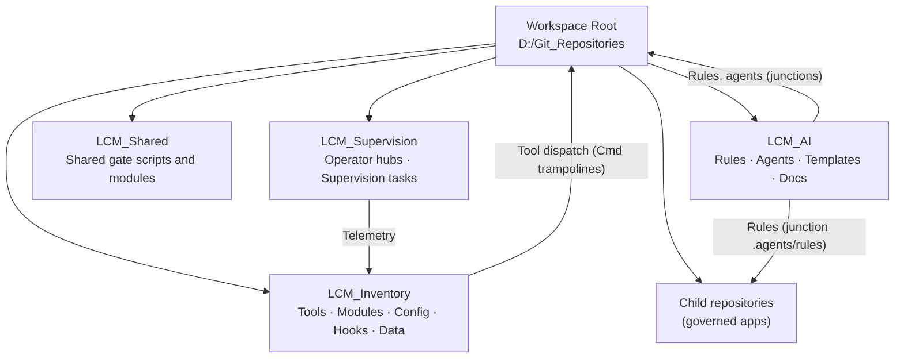
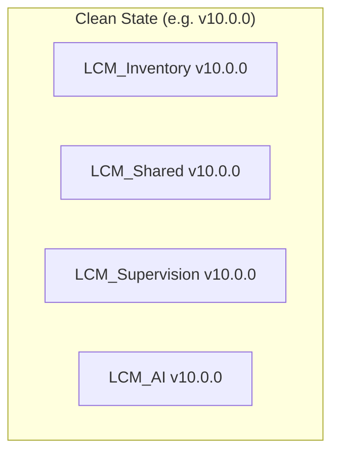
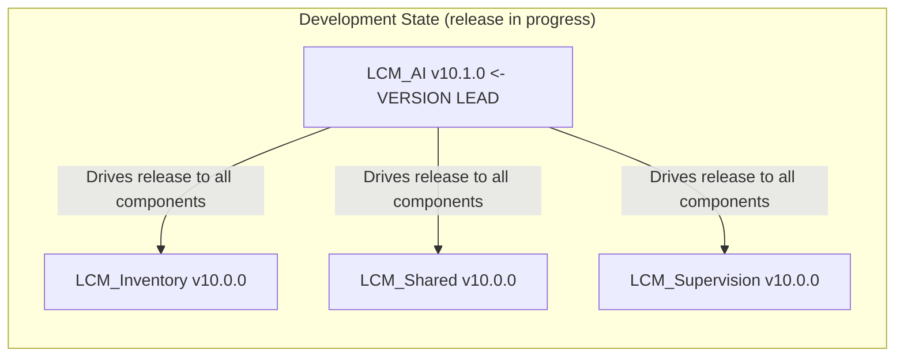

# LCM Subsystem Architecture - Boundaries & Governance

Module: LCM_AI/docs/LCM_Subsystem_Architecture.md
Purpose: Subsystem taxonomy, ownership boundaries, log routing and repository tracking for the current LCM workspace.
Path: D:/Git_Repositories/LCM_AI/docs/LCM_Subsystem_Architecture.md
Authors: Rolf, LCM_AI Engine
Version: 10.2.0
Status: Authoritative Architecture
Date: 2026-10-21
Supersedes: LCM_LCD_Subsystem_Architecture.md (retired two-folder design with `.lcm` / `.lcd`)

---

## 1. Summary

The workspace root `D:\Git_Repositories\` is a container of independent Git repositories. Governance
lives in three of them; the rest are governed child repositories. There are no hidden subsystem
folders. The retired folders `.lcm` and `.lcd` must never exist (enforced by
`LCM_Inventory/config/structure.lock.json` and `LCM_Inventory/tools/Test-Guardrail.ps1`).



---

## 2. Subsystems

### 2.1 LCM_Inventory - Tools, Configuration and Data

| Attribute | Value |
|:---|:---|
| **Domain** | Operational tools, modules, platform configuration, git hooks, CM data (proposals, reviews, logs, baselines) |
| **Layout** | `tools/`, `modules/`, `config/`, `.githooks/`, `Cmd/`, `data/`, `docs/`, `tests/` |
| **Write authority** | CM tools and governance-authorized agents |

- `tools/` holds the operational scripts; `config/tool_catalog.json` is the single source for tool discovery (`RULE-EFF-008`).
- `config/` holds platform configuration, including `lcm-path-map.json`, `guardrails.json` and `structure.lock.json`.
- `data/` is the single authoritative data and log sink (see section 3).

### 2.2 LCM_AI - Rules, Agents and Templates

| Attribute | Value |
|:---|:---|
| **Domain** | Canonical governance rules (`.agents/rules/`), agent definitions, templates, quality gate tooling |
| **Distribution** | The root `.agents` and `.copilot` entries and each governed repo's `.agents/rules` are junctions into `LCM_AI` |

`LCM_AI` is the only physical owner of the rule files. Nothing else keeps copies.

### 2.3 LCM_Shared - Shared Gate Components

Gate scripts and modules used by several repositories (readiness and review gates).

### 2.4 LCM_Supervision - Operator Interaction

Operator hubs and scheduled supervision tasks. It owns interaction surfaces only. Telemetry goes to `LCM_Inventory/data/logs/`.

### 2.5 Child Repositories

Governed application repositories. Each carries an `AGENTS.md`; an `Elevation: Administrator` line there marks repositories that require elevation. There is no per-repository `.lcm` folder.

---

## 3. Logging Architecture - Canonical Routing Specification

> **Invariant**: All execution traces, audit trails, supervision telemetry and agent-generated logs are routed exclusively to `LCM_Inventory/data/logs/`.

### 3.1 Canonical Log Directory Tree

```
LCM_Inventory/
└── data/
    └── logs/                              <- canonical log root (all subsystems)
        ├── lcm/                           <- operational tool output
        │   └── <ToolName>_YYYY-MM-DD.log
        ├── lcm-internal/                  <- internal tool traces
        ├── crp/, history/                 <- proposal and history records
        ├── guardrails.log                 <- guardrail decisions
        ├── supervision/                   <- LCM_Supervision task output (planned)
        ├── agent/                         <- agent session output (planned)
        └── cm/                            <- CM audit trails, review records (planned)
```

Status: `lcm/`, `lcm-internal/`, `crp/` and `history/` exist today; the folders marked planned come from the original design and are created on first use.

### 3.2 Log Routing Table

| Source Subsystem | Canonical Destination | Routing Mechanism |
|:---|:---|:---|
| `LCM_Inventory/tools/` operational scripts | `data/logs/lcm/` | `$logDir` default parameter in all tools |
| `LCM_Supervision/` task runner | `data/logs/supervision/` | `Invoke-SupervisionRunner.ps1` log path |
| `LCM_AI/` agent workflows | `data/logs/agent/` | agent session log routing configuration |
| CM audit operations | `data/logs/cm/` | `Invoke-WorkspaceAudit.ps1` default target |
| `.agents/logs/` (legacy) | **Deprecated** -> `data/logs/agent/` | migration per CRP-2026-036 |

### 3.3 Log Format Standard

All log entries conform to `RULE-PS-009` (Mandatory Structured Tool Logging):

```
[YYYY-MM-DD HH:mm:ss.fff] [LEVEL] [ToolName vX.Y.Z] Message text here
```

Permitted levels: `[INFO]` `[WARN]` `[ERROR]` `[DEBUG]` `[ACTION]` `[SUMMARY]`. Logs are gitignored runtime state.

---

## 4. Tool Isolation Boundary - Apps and Submodules

### 4.1 Motivation

`LCM_Inventory/tools/` is the critical operational substrate of the workspace. Unauthorized or accidental agent edits silently corrupt workspace-wide workflows. A formal boundary enforces a CM change gate at the file-system level.

### 4.2 Boundary Forms

Operator decision 2026-10-09: submodules are a normal form of the App method, usable to subdivide a large set of functionality of a repository. The boundary for `tools/` may be realised as:

1. a git submodule (pinned commit, deliberate entry into the submodule context to change it), or
2. an App folder with a constituent manifest inside the repository, protected by the guardrail blast-radius scan and the review gate.

Original layout (submodule form):

```
D:\Git_Repositories\
└── LCM_Inventory\
    └── tools\                  <- boundary: LCDTools
        ├── internal\           <- core internal tools (agent: read-only)
        ├── Cmd\                <- short-name trampolines
        ├── hub\                <- HTML dashboards
        └── hooks\              <- git hooks
```

Status: `tools/` is currently a plain folder of `LCM_Inventory` (no `.gitmodules`), protected by the guardrail scan (`Test-Guardrail.ps1`) and the review gate. Which form to use is an operator decision.

### 4.3 Boundary Invariants

1. **Agent read-only boundary**: agents see `tools/` as protected. Modifying it is a deliberate, auditable action.
2. **Formal CM promotion**: changes to `tools/` require a CM proposal at T1 or higher and the review gate (Beyond Compare + `ACCEPTED`, `RULE-REV-001`). In the submodule form this also means a submodule commit followed by a pointer-update commit in the parent.
3. **Version pinning** (submodule form): the parent pins the tool layer to a specific commit SHA for reproducible tool versions across clones.
4. **Blast radius containment**: runaway agent loops or script errors must not reach the tool layer without crossing the commit boundary.

### 4.4 Enforcement

Per `RULE-EFF-008`: agents use `tool_catalog.json` for tool discovery. Broad file-system scans across `.ps1`/`.psm1` files in `LCM_Inventory/tools/` to locate or modify tool signatures are prohibited.

### 4.5 Planned: Handy_Tools

Several small child repositories may later be consolidated into one repository ("Handy_Tools") with one App per former repository, history merged in. Done by operator decision only; not started.

---

## 5. Repository Tracking Specification

### 5.1 Policy (original design: inverted `.gitignore` whitelist)

The `LCM_Inventory/` repository was designed to track a curated subset of its tree using an inverted whitelist:
- **Default posture**: new files and directories are excluded unless explicitly whitelisted.
- **Essential governance artifacts** (config, documentation, module source) are always tracked.
- **Transient runtime state** (logs, scratch files, archive snapshots) is never committed.

Status: the live `.gitignore` is currently a blacklist of runtime state (`scratch/`, `archive/`, `data/logs/lcm/`, `data/artifacts/`, ...). Rules are tracked in `LCM_AI` only (`.agents/rules/` is ignored in `LCM_Inventory`). Whether to return to the whitelist is an operator decision. The guardrail scan reports ignored files inside the blast radius (`tools`, `modules`, `config`, `.githooks`, `.github`) in either case.

### 5.2 Canonical Whitelist Template (original design)

```gitignore
# LCM_Inventory/.gitignore - Inverted Whitelist Policy (CRP-2026-036)
# Default: exclude everything. Whitelist only essential tracked subtrees.

/*
/*/

# -- Whitelisted governance artifacts --
!/config/
!/docs/
!/install/
!/modules/
!/tests/
!/tools          # submodule pointer (or tracked folder, see 4.2)

# -- Always excluded: transient runtime state --
/logs/
/scratch/
/archive/
**/*.log
**/*.tmp
**/*.bak
**/*.swp
**/scratch/
**/logs/
**/archive/
```

### 5.3 Tracking Policy Matrix

| Item | Policy | Rationale |
|:---|:---|:---|
| New subdirectory under `LCM_Inventory/` | Excluded by default (whitelist form) | prevent accidental tracking of runtime state |
| `*.log` files anywhere | Always excluded | all logs route to `LCM_Inventory/data/logs/` |
| `scratch/`, `*.tmp`, `*.bak` | Always excluded | transient, non-governance artifacts |
| `LCM_AI/.agents/rules/*.md` | Always tracked | canonical governance artifacts |
| `modules/**/*.ps1`, `*.psm1` | Always tracked | versioned platform module source |
| `config/tool_catalog.json` | Always tracked | authoritative tool registry |
| `archive/` snapshots | Always excluded | historical snapshots managed separately |
| `config/*.json` | Always tracked | platform configuration |

---

## 6. Architectural Invariants (Non-Negotiable)

| # | Invariant | Reference |
|:---|:---|:---|
| 1 | No `.lcm` / `.lcd` folders; structure is checked by `Test-Guardrail.ps1 -Scan` | `structure.lock.json` |
| 2 | Single log sink: `LCM_Inventory/data/logs/` | `RULE-EFF-001` |
| 3 | Rules have one physical owner (`LCM_AI`) and are distributed by junction | `RULE-AUTHORITY` |
| 4 | Tool isolation boundary (section 4): changes need a CM proposal and the review gate | `RULE-REV-001` |
| 5 | Tool discovery through `tool_catalog.json` | `RULE-EFF-008` |
| 6 | No speculative paths: anchor to `$PSScriptRoot` or a resolved root, no Join-Path chains | `RULE-ENV-003` |
| 7 | Search dispatch: `es.exe` first, then `rg.exe` (`Search-Everything.ps1`) | `RULE-EFF-007` |
| 8 | Review gate before commit (`ACCEPTED`), with the documented bypasses; Good Night is unattended and commits without it | `RULE-REV-001` |
| 9 | Governance changes by AI require consent (guardrails, mode `ask`) | `guardrails.json` |
| 10 | No specification document is replaced or shortened without operator approval | `RULE-DOC-008` |

---

## 7. Version Synchronization Invariant

### 7.1 Clean-State Version Parity

In a clean, released state every LCM component (`LCM_Inventory`, `LCM_AI`, `LCM_Shared`, `LCM_Supervision`) carries the same version. Versions are never hand-edited; they are propagated by the governed tooling (`Sync-LcmModuleVersions.ps1`, `Advance-Governance.ps1`) as part of a CM release cycle.



**Invariant**: a workspace is clean only if all tracked version fields are equal. A mismatch is a governance drift condition and must be resolved before formal review gates or baseline captures.

### 7.2 Development-State Version Lead

While the LCM is being modified or a release is prepared, `LCM_AI` temporarily carries a higher version than all other components. This is the signal that a release cycle is in progress.



**Rationale**: `LCM_AI` is the Baseline Authority; it holds the design in progress, quality gates and pending rule updates. No other component self-increments; only `LCM_AI` initiates a version advance.

### 7.3 Version Lifecycle State Machine

```
[Clean v10.0.0]  <- all components at parity
      |
      |  Operator opens a new release cycle -> bumps LCM_AI to v10.1.0
      v
[Development: LCM_AI=v10.1.0, all others=v10.0.0]
      |
      |  Modifications authored, proposals registered, reviews completed
      v
[CM Release: tooling propagates v10.1.0 to all remaining components]
      |
      |  Sync-LcmModuleVersions.ps1 confirms parity across all Version: fields
      v
[Clean v10.1.0]  <- parity restored; workspace is releasable
```

### 7.4 Version Field Locations

| Component | Canonical Version Field |
|:---|:---|
| `LCM_Inventory/` | `LCM_Inventory/docs/Architecture.md` header `Version:` |
| `LCM_Inventory/tools/` | `config/tool_catalog.json` root `"version"` key |
| `LCM_Supervision/` | `LCM_Supervision/docs/Architecture.md` header `Version:` |
| `LCM_AI/` | `LCM_AI/docs/Architecture.md` header `Version:` (version lead during development) |

Status: the 10.0.0 reset is pending; the numbers above are the target state, and the tooling still has to be adapted from its 7.x baseline.

---

## 8. Cross-Reference Index

| Document | Path | Relationship |
|:---|:---|:---|
| LCM Rules Cross-Reference | `LCM_AI/docs/LCM-Rules-Cross-Reference.md` | normative rule definitions |
| LCM Tooling Hub Architecture | `LCM_Inventory/docs/Architecture.md` | tool hub subsystem detail |
| LCM_AI Architecture | `LCM_AI/docs/Architecture.md` | system topology and version lead |
| MethodEfficiencyPolicy | `.agents/rules/MethodEfficiencyPolicy.md` | `RULE-EFF-007`, `EFF-008`, `ENV-003` |
| PowerShellStandardsPolicy | `.agents/rules/PowerShellStandardsPolicy.md` | `RULE-PS-009`, `PS-015` |
| ProposalReviewFlowPolicy | `.agents/rules/ProposalReviewFlowPolicy.md` | `RULE-LCM-001`..`024` |
| DocumentationStandardsPolicy | `.agents/rules/DocumentationStandardsPolicy.md` | `RULE-DOC-001`..`008` |
| Active Context | `LCM_AI/.agents/ACTIVE_CONTEXT.md` | current workspace context |
| Learned Advice | `LCM_AI/.agents/LEARNED_ADVICE.md` | binding AI-to-AI advice |
| CRM Proposals Ledger | `LCM_Inventory/data/proposals/proposals.json` | proposals |

---

## 9. Planned

- Single root variable `LCM_ROOT` (machine/registry value) replacing the Git root, and a `D:\LCM_Root` workspace.
- Possible SuperJunction scheme (requires an amendment of the junction rule).
- Reset of all component versions to 10.0.0.
- Handy_Tools consolidation (section 4.5), by operator decision only.
